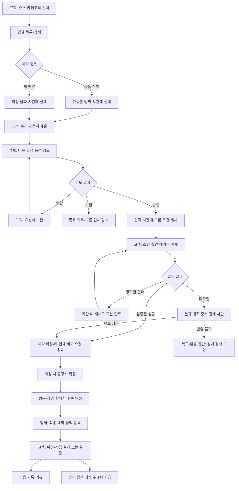
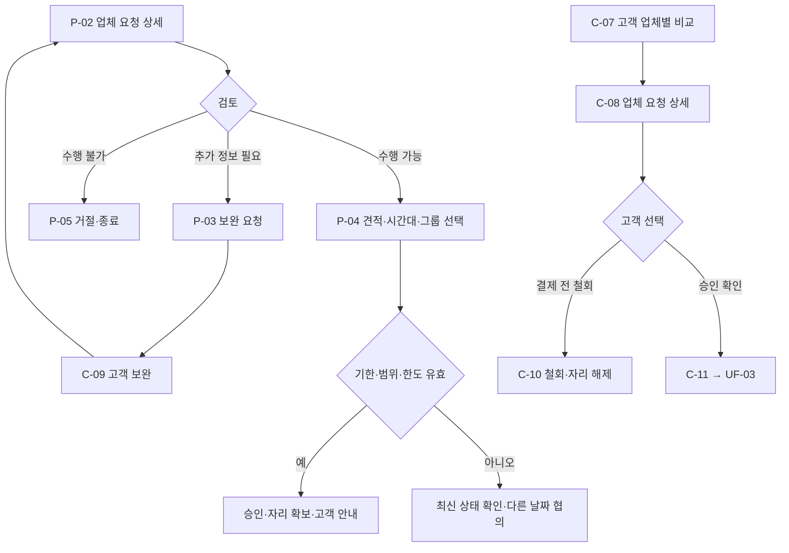
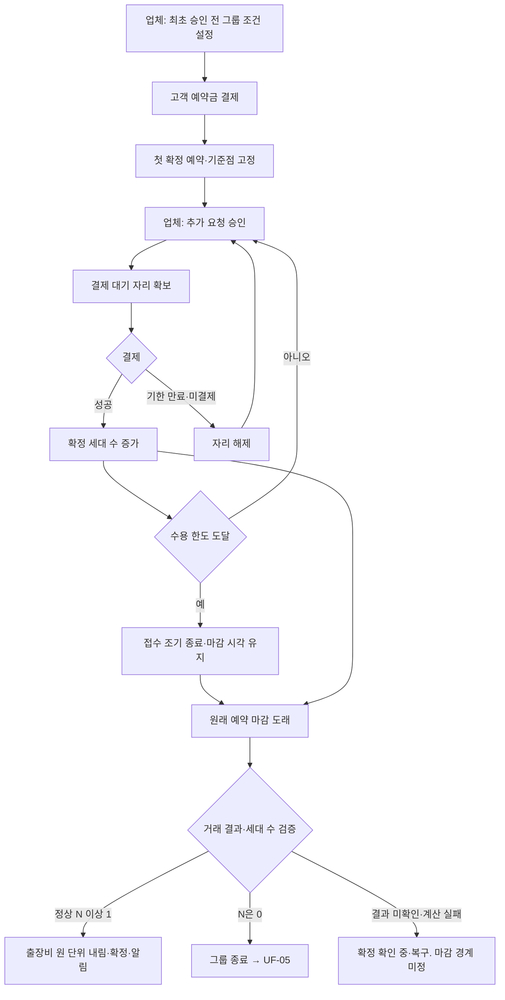
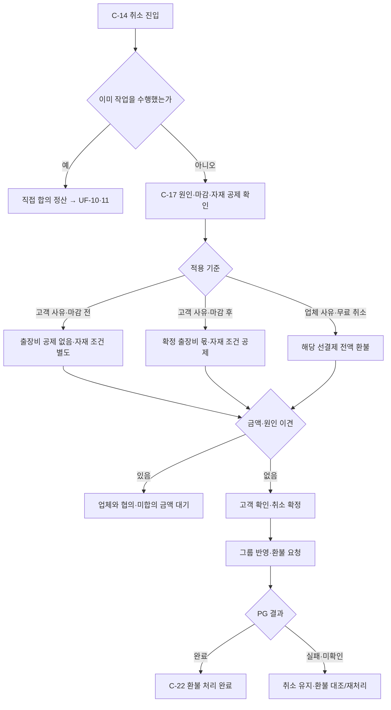
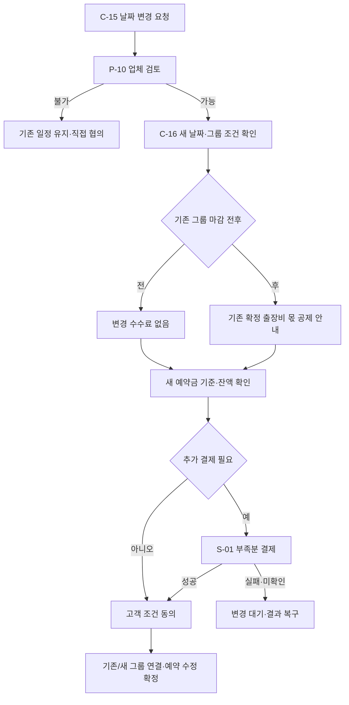
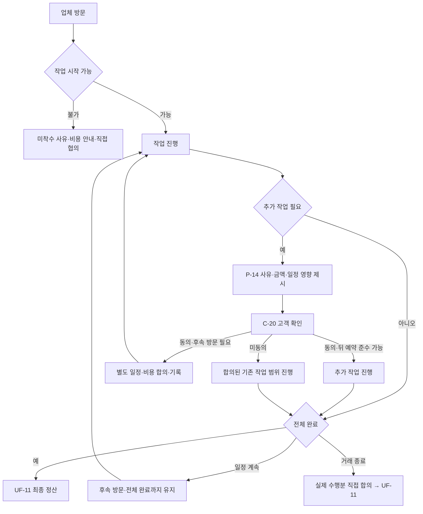
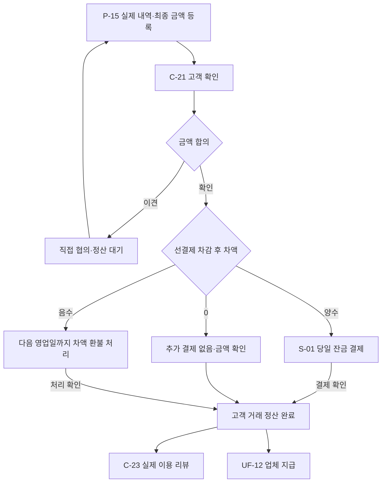

# User Flow

> Notion 원문을 읽기용으로 복사한 참고본입니다(출처: https://app.notion.com/p/3f394c8725ff80d38076e6f0f48dca9f). 원문이 우선합니다.

Here is the result of "fetch" for the Page with URL https://app.notion.com/p/3f394c8725ff80d38076e6f0f48dca9f as of 2026-10-08T06:26:43.546Z:
<page url="https://app.notion.com/p/3f394c8725ff80d38076e6f0f48dca9f">
<ancestor-path>
<parent-page url="https://app.notion.com/p/3f394c8725ff80dcb275f01930addaae" title="생활 수리 공동 예약 서비스 - 온김에"/>
</ancestor-path>
<properties>
{"title":"User Flow"}
</properties>
<iconMetadata>null</iconMetadata>
<content>
<table header-row="true">
<tr>
<td>항목</td>
<td>내용</td>
</tr>
<tr>
<td>버전·작성일</td>
<td>v0.1 / 2026-10-08</td>
</tr>
<tr>
<td>기준</td>
<td>PRD·IA·서비스 정책서·에러 정책서 v0.1</td>
</tr>
<tr>
<td>연계 문서</td>
<td>[상세 기능 명세서](/p/3f394c8725ff80b0b93ec3c93403a0ee?pvs=25)</td>
</tr>
<tr>
<td>범위</td>
<td>고객·업체의 정상 흐름, 변경·종료, 금전 처리·시스템 예외</td>
</tr>
</table>
화면 ID는 IA를 따른다. UF는 흐름, FN은 상세 기능, POL은 서비스 정책, ERR은 에러 정책의 식별자다. 다이어그램의 ‘미정’은 구현 분기를 임의로 확정하지 않고 출시 전 결정할 부분이다. 기술 스택·웹/앱·인증 방식은 확정하지 않는다. 앱 내 채팅·신고·가격 판정·수리 중재 흐름은 포함하지 않는다.
## 1. 흐름 목록
<table header-row="true">
<tr>
<td>ID</td>
<td>흐름</td>
<td>기능 연결</td>
</tr>
<tr>
<td>UF-01</td>
<td>탐색·공동 참여/새 날짜 요청</td>
<td>FN-01\~04</td>
</tr>
<tr>
<td>UF-02</td>
<td>검토·보완·비교·철회·승인</td>
<td>FN-05\~07</td>
</tr>
<tr>
<td>UF-03</td>
<td>승인 확인·예약금 결제·확정</td>
<td>FN-08\~10</td>
</tr>
<tr>
<td>UF-04</td>
<td>그룹·자리·마감·출장비 확정</td>
<td>FN-11\~12</td>
</tr>
<tr>
<td>UF-05</td>
<td>최초 취소·전체 취소·새 그룹</td>
<td>FN-13</td>
</tr>
<tr>
<td>UF-06</td>
<td>고객 취소·환불</td>
<td>FN-14\~15</td>
</tr>
<tr>
<td>UF-07</td>
<td>고객 날짜/시간 변경</td>
<td>FN-16\~17</td>
</tr>
<tr>
<td>UF-08</td>
<td>업체 변경·취소·방문 지연</td>
<td>FN-18\~19</td>
</tr>
<tr>
<td>UF-09</td>
<td>자재 동의·구매·문제 발생</td>
<td>FN-20</td>
</tr>
<tr>
<td>UF-10</td>
<td>추가 작업·후속 방문·중단</td>
<td>FN-21\~22</td>
</tr>
<tr>
<td>UF-11</td>
<td>최종 금액·잔금·환불·리뷰</td>
<td>FN-23\~25</td>
</tr>
<tr>
<td>UF-12</td>
<td>업체 지급·오류 복구</td>
<td>FN-26\~29</td>
</tr>
</table>
## 2. 전체 흐름

고객의 취소·변경·업체 지연은 예약 확정 이후 각 해당 흐름으로 분기한다. 예약 상세는 최초 결제 직후부터 접근 가능하며 마감을 기다려야 열리는 화면이 아니다. 자재 선결제가 필요한 흐름은 UF-09에서 별도로 관리한다.
## 3. UF-01 — 탐색·요청
**시작:** 고객이 업체 찾기에 진입. **종료:** 요청 접수 또는 탐색 유지.
<table header-row="true">
<tr>
<td>순서</td>
<td>주체·화면</td>
<td>행동·시스템 결과</td>
</tr>
<tr>
<td>1</td>
<td>고객 C-01\~02</td>
<td>방문 주소 입력. 서비스가 단지/반경 판단에 필요한 주소 정보를 확인</td>
</tr>
<tr>
<td>2</td>
<td>고객 C-03</td>
<td>카테고리별 업체 확인. 해당 주소로 참여 가능한 접수 중 그룹이 있을 때만 공동 예약 표시</td>
</tr>
<tr>
<td>3</td>
<td>고객 C-04</td>
<td>수행 작업·리뷰·출장비·사후 조건 확인</td>
</tr>
<tr>
<td>4A</td>
<td>고객 C-04</td>
<td>공동 예약 날짜와 요청 가능한 시간대 선택. 업체 승인 전 미확정 안내</td>
</tr>
<tr>
<td>4B</td>
<td>고객 C-04\~05</td>
<td>새 예약의 희망 날짜·시간대 선택</td>
</tr>
<tr>
<td>5</td>
<td>고객 C-05</td>
<td>작업·설명·사진·상세 주소·가능 시간대 작성. 여러 작업 추가 가능</td>
</tr>
<tr>
<td>6</td>
<td>시스템</td>
<td>선택 업체·작업·날짜·그룹 맥락을 연결해 접수, C-08로 이동, 업체에 알림</td>
</tr>
</table>
**분기:** 주소 판단 실패 ERR-ADDR-01\~02, 범위 불일치 ERR-ADDR-03, 사진 실패 ERR-REQ-02, 중복 접수 ERR-REQ-03. 업체/공동 예약 없음은 정상 빈 상태다. 인증 필요 시 S-04를 거치며 정확한 인증 시점은 미정이다. 여러 업체 요청 방식은 자동 일괄 발송으로 확정하지 않는다.
## 4. UF-02 — 검토·보완·비교·승인

- 업체 응답 없음은 자동 거절이 아니다. 고객은 연락·철회·타 업체 문의 가능.
- 기존 승인 견적의 임의 변경 절차는 두지 않는다.
- 승인 시 기존 그룹 연결 또는 신규 그룹 조건을 업체가 판단한다.
- 승인 기한은 마감 1시간 전, 결제 기한은 승인+24시간과 마감 중 빠른 시각.
- 같은 비교 요청에서 한 업체 결제가 완료되면 다른 업체 건은 종료하되 별개 수리 요청은 유지.
- 승인과 고객 철회가 동시에 발생하면 최신 상태를 검증하고 ERR-REQ-05 적용.
## 5. UF-03 — 결제·예약 확정
**사전 조건:** 유효 승인, 고객 본인, 결제 기한 내, 조건 재확인이 필요하지 않은 상태.
<table header-row="true">
<tr>
<td>순서</td>
<td>행동</td>
<td>결과</td>
</tr>
<tr>
<td>1</td>
<td>C-11에서 조건·예상 총액·지금 결제액·기한 확인</td>
<td>현재 조건 버전 확인</td>
</tr>
<tr>
<td>2</td>
<td>필요한 동의 후 S-01 결제 시작</td>
<td>거래 의도 생성, 중복 클릭 차단</td>
</tr>
<tr>
<td>3</td>
<td>PG 결제 및 서버 결과 검증</td>
<td>성공/실패/미확인 구분</td>
</tr>
<tr>
<td>4A</td>
<td>성공·유효 조건 확인</td>
<td>예약 확정, 그룹 확정 세대 수 반영, 타 비교 요청 종료·자리 해제</td>
</tr>
<tr>
<td>4B</td>
<td>명확한 실패</td>
<td>기한·조건 유효 시 재시도, 만료 시 승인 종료</td>
</tr>
<tr>
<td>4C</td>
<td>결과 미확인</td>
<td>대조 중 표시, 추가 결제 차단. 경계 처리 미정</td>
</tr>
<tr>
<td>5</td>
<td>성공 결과 표시</td>
<td>C-14 예약 상세 및 결제 기록 접근, 고객·업체 알림</td>
</tr>
</table>
결제 시작과 결제 완료는 다르다. PG 성공이면서 서비스 반영 실패는 ERR-PAY-04로 복구한다. 같은 사건은 한 번만 반영한다. 성공이지만 마감·자리 조건 불충족, 타 업체 동시 결제는 별도 결과 대조 대상으로 남긴다. 이 분기의 예약 유지 우선순위·환불은 출시 전 결정한다.
예약금 성공으로 예약 확정하는 합의는 유지한다. 자재비를 같은 결제에 묶을지, 별도로 언제 받는지는 미정이므로 자재 미결제 시 예약 취소를 임의로 추가하지 않는다.
## 6. UF-04 — 그룹·마감·출장비 확정

한도는 확정 예약+결제 대기 자리를 포함한다. 출장비 계산은 결제 완료 세대만 포함한다. 빈자리 재접수는 마감 전 가능하되 업체 승인은 마감 1시간 전까지다. 마감 후 새 참여나 분담액 증가를 자동 허용하지 않는다.
## 7. UF-05 — 최초 고객·전체 확정 예약 취소
1. 취소를 처리하고 남은 확정 예약을 확인한다.
2. 남은 예약이 있으면 기존 기준점·그룹·방문 시간대를 유지한다.
3. 없으면 기존 그룹 종료, 결제 대기 고객의 기존 조건 결제 경로 차단.
4. C-12에서 종료 사실·새 조건·혼자 결제하면 출장비 전액 부담 가능성을 안내한다.
5. 업체가 새 범위·마감·동선을 확인하고 변경 조건을 고객이 동의한다.
6. 먼저 유효 결제를 완료한 고객을 새 최초 고객으로 지정한다.
7. 다른 대기 요청은 새 기준으로 참여 가능 여부와 조건을 재확인한다.
마감이 임박해 승인·결제 최소 시간을 확보할 수 없거나 둘 이상의 고객이 새 최초 결제를 경쟁하는 경우는 ERR-GRP-06 및 ED-01\~03의 결정이 필요하다. 대기 고객을 알림만 보낸 뒤 자동으로 새 그룹에 확정하지 않는다.
## 8. UF-06 — 취소·환불

무료 취소 사유가 적용되는 예약을 일반 고객 사유 공제 경로로 보내지 않는다. 마감 전 취소는 남은 예상 분담액을 재계산하고 마감 후에는 남은 확정 금액을 유지한다. 환불액 확정 후 다음 영업일까지 플랫폼 처리를 완료하며 실제 반영 기간은 결제수단별 안내한다. 이견 중 취소 효력 시각·부분 환불·마감 경계는 미정이다.
## 9. UF-07 — 고객 날짜·시간 변경
**시간 변경:** C-15 요청 → P-10 업체가 다른 시간대 영향 검토 → 불가 시 기존 시간 유지 / 가능 시 무료 승인 → C-14 반영. 그룹·출장비는 유지한다.
**날짜 변경:**

기존 견적·자재 주문·자재 선결제를 유지한다. 새 그룹 금액이 달라 초과 예약금이 생길 때, 부족분 결제 실패 시 원래 공제·자리 복원, 변경 처리 시각이 마감을 넘기는 경우는 미정이다. 위 순서는 처리 의도를 설명하며 공제·그룹 이동을 언제 확정할지는 ED-05에서 정한다.
## 10. UF-08 — 업체 일정 변경·취소·지연
<table header-row="true">
<tr>
<td>상황</td>
<td>흐름·결과</td>
</tr>
<tr>
<td>업체 날짜 변경</td>
<td>P-10 변경 이유·새 조건 등록 → C-16 고객 수락/거절 → 수락 시 변경, 거절 시 무료 취소·전액 환불</td>
</tr>
<tr>
<td>마감 전 업체 변경</td>
<td>새 날짜·마감·예상 출장비 안내·재동의</td>
</tr>
<tr>
<td>마감 후 업체 변경</td>
<td>수락 고객 기존 확정 출장비 유지. 감소분을 남은 고객에게 청구하지 않음</td>
</tr>
<tr>
<td>업체 취소</td>
<td>P-12 원인·내용 등록 → 고객 예약금·자재 선결제 전액 환불, 기록 유지</td>
</tr>
<tr>
<td>지연 예상</td>
<td>P-11 예상 도착 등록 → C-18 최신 일정 안내</td>
</tr>
<tr>
<td>시간대 초과 지연</td>
<td>고객 기다리기/무료 변경/무료 취소 → 합의 변경 또는 전액 환불</td>
</tr>
</table>
무응답을 일정 변경 동의로 간주하지 않는다. 무료 선택권을 ‘지연 예상 시점’부터 활성화할지, 기다리기 후 재지연 대응은 미정이다. 지연 알림이 실패해도 C-14의 현재 상태는 유지하며 전송 실패를 표시·복구한다.
## 11. UF-09 — 자재
1. 업체가 일반 부품/맞춤·특별 주문을 구분한다.
2. 일반 부품은 최종 정산 기본. 필요한 선결제는 사유·금액을 제시한다.
3. 특별 주문은 P-13에서 품목·규격·수량·금액·납기·취소 조건 등록.
4. 고객 C-19 별도 동의 → 자재비 선결제 → 성공 확인.
5. 업체가 자기 비용으로 주문하고 상태·증빙 등록. 플랫폼 선지급 없음.
6. 입고 후 작업 진행. 도착 지연·오주문이면 무료 변경/취소 흐름 UF-08 적용.
7. 고객 사유 취소는 가능한 주문 취소·반품을 확인하고 회수 불가능한 실제 비용만 적용 조건에 따라 공제.
8. 완료 시 자재 선결제를 최종 대금에서 차감하고 업체 지급 대상으로 연결.
미동의·미결제면 주문을 진행하지 않는다. 자재비 미결제로 예약 확정이 무효가 되는지, 자재 증빙·실물 인도·선결제보다 큰 비용은 미정이다. 자재비 전체를 단순히 환불 불가로 자동 처리하지 않는다.
## 12. UF-10 — 작업·추가 작업·후속 방문·종료

미착수 고객 사유/충분한 사전 확인에도 발견 불가한 문제는 확정 출장비, 업체 사유는 면제 기준이다. 진단비는 사전 동의가 있을 때만 적용한다. 이미 일부 수행한 거래는 미착수 환불 기준으로 자동 정산하지 않고 직접 합의 금액을 사용한다. 기존 작업이 길어지면 뒤 예약은 UF-08 지연 대응으로 연결한다.
## 13. UF-11 — 최종 정산·리뷰

‘거래 정산 완료’의 세부 시스템 기준, 특히 환불 처리 진행 중 리뷰 자격·업체 지급 조건은 미정이다. 위 도식은 안정적인 결과가 확인된 정상 종료 기준이다. 고객이 최종 금액에 이견을 제시하면 당일 결제 의무를 보류하고 자동 청구하지 않는다. 미확인과 이견을 분리하고 후속 응답 기한은 임의로 만들지 않는다.
## 14. UF-12 — 업체 지급·시스템 복구
1. 정상 거래는 완료·고객 금액 확인·결제 조건, 취소 거래는 환불액·업체 몫 확정 조건을 확인한다.
2. 할인 후 작업비에 업체 부담 비율 수수료를 계산한다. 요율은 미정.
3. 출장비·자재비·취소수수료는 수수료 제외. 0원/환불/중단 정산의 수수료는 미정.
4. PG 대금 수령 여부를 확인하고 주 1회 대상 지급 묶음을 구성한다.
5. 지급 실행 → 성공은 완료, 명확한 실패는 원인 확인, 결과 미확인은 대조 중·재송금 차단.
6. 금액 이견·정합성 문제가 있는 거래만 보류하고 다른 거래는 정상 지급한다.
7. 운영자는 권한 범위 안에서 결과 대조·재처리 기록을 남긴다. 권한·기한·지급일은 미정.
## 15. 공통 불변 조건과 출시 전 분기
<table header-row="true">
<tr>
<td>유지 조건</td>
<td>적용 흐름</td>
</tr>
<tr>
<td>고객 주소·요청 내용은 본인·해당 업체만 조회</td>
<td>전체</td>
</tr>
<tr>
<td>승인과 예약 확정 구분, 결제 완료만 확정 세대</td>
<td>UF-02\~04</td>
</tr>
<tr>
<td>같은 금액을 중복 결제·공제·환불·지급하지 않음</td>
<td>금전 흐름 전체</td>
</tr>
<tr>
<td>마감 후 다른 세대 분담액을 올리지 않음</td>
<td>UF-06\~08</td>
</tr>
<tr>
<td>고객 동의 없는 비용 변경·자동 청구 없음</td>
<td>UF-07\~11</td>
</tr>
<tr>
<td>환불 실패가 취소 확정을 되돌리지 않음</td>
<td>UF-06</td>
</tr>
<tr>
<td>현장 가격·품질·원인 판단은 직접 협의</td>
<td>UF-08\~11</td>
</tr>
</table>
미정 분기는 서비스 정책서 TBD-01\~16, 에러 정책서 ED-01\~12를 그대로 참조한다. 특히 결제·마감 경계, 동시 업체 결제, 새 그룹 경쟁, 날짜 변경 부분 성공, 미응답·자재 선결제 순서는 실결제 출시 전에 확정한다. 결정 전 테스트가 가능한 정상 흐름과 결정이 필요한 경계 흐름을 나눠 개발한다.
</content>
</page>